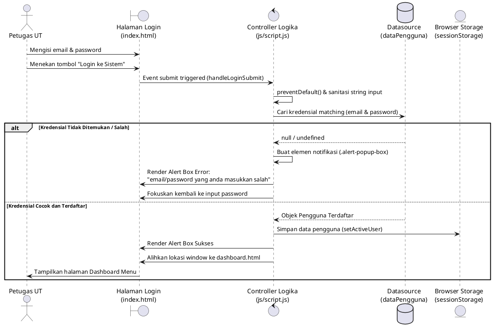
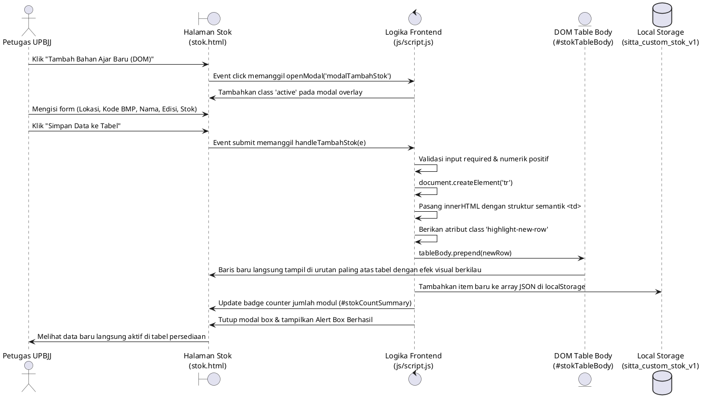
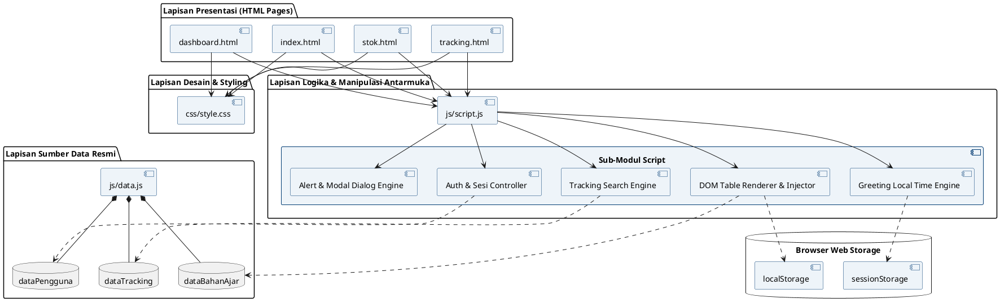

# LAPORAN TUGAS PRAKTIK 1
## Aplikasi Pemesanan dan Distribusi Bahan Ajar (SITTA) Universitas Terbuka
### Implementasi 4 Halaman Berbasis HTML5 Semantik, CSS (Inline, Internal, External), dan JavaScript DOM Tanpa Backend

---

## 1. Identitas dan Latar Belakang Soal Tugas

- **Mata Kuliah**: Pemrograman Berbasis Web / Praktik Kerja Front-End
- **Program Studi**: Sistem Informasi - Universitas Terbuka
- **Topik Tugas**: Implementasi Fundamental HTML, CSS, dan JavaScript DOM untuk Antarmuka Aplikasi Pemesanan dan Distribusi Bahan Ajar SITTA di UT-Daerah.
- **Batasan Arsitektur**:
  - Murni Front-End (HTML, CSS, JavaScript DOM) tanpa server backend atau framework reactive (React/TSX tidak digunakan untuk rendering antarmuka pengguna).
  - Sumber data dibaca langsung dari berkas JavaScript resmi (`js/data.js`).
  - Tidak menggunakan icon library atau emoticon unicode pada antarmuka. Seluruh antarmuka menggunakan teks bersih, tipografi kelembagaan resmi, dan penataan CSS murni.
- **Sumber Referensi Penelitian Dosen Universitas Terbuka**:
  1. Sufandi, U. U., Aprijani, D. A., & Pandiangan, P. (2021). *Evaluasi dan hasil review desain user interface prototype aplikasi mobile SITTA Universitas Terbuka*. Jurnal Nasional Pendidikan Teknik Informatika (JANAPATI), 10(3), 147-156. https://doi.org/10.23887/janapati.v10i3.39860
  2. Sufandi, U. U. (2022). *Analisis Kebutuhan dan Dokumentasi Sistem Informasi Tiras dan Transaksi Bahan Ajar Universitas Terbuka*. Jurnal Nasional Pendidikan Teknik Informatika (JANAPATI), 11(2), 112-122. https://doi.org/10.23887/janapati.v11i2.42966

---

## 2. Struktur Direktori dan Modul Berkas (File Structure)

Struktur direktori dirancang modular dan terpisah secara tegas antara struktur dokumen (HTML), desain presentasi (CSS), data konstanta (Data JS), dan logika interaksi/manipulasi DOM (Script JS):

```text
sitta-praktik/
├── index.html                  [Halaman 1] Login Petugas & Layanan Autentikasi
├── dashboard.html              [Halaman 2] Dashboard Menu Utama, Greeting Waktu & Laporan DO
├── tracking.html               [Halaman 3] Pelacakan Delivery Order Bahan Ajar
├── stok.html                   [Halaman 4] Informasi Persediaan Modul & Tambah Baris DOM
├── css/
│   └── style.css               Berkas Stylesheet Eksternal (UT Design System, Layout, Komponen)
├── js/
│   ├── data.js                 Datasource Resmi (dataPengguna, dataBahanAjar, dataTracking)
│   └── script.js               Modul Logika Frontend, Validasi Form, Navigasi & Manipulasi DOM
├── README.md                   Dokumentasi Ringkas dan Petunjuk Penggunaan Aplikasi
└── LAPORAN_TUGAS_PRAKTIK_1.md  Laporan Komprehensif Berpraktik & Panduan Video Penjelasan
```

### Peran dan Keterkaitan Antar Berkas:
1. `index.html`: Berkas entry-point utama aplikasi. Berisi formulir otentikasi login, modal box lupa kata sandi, modal box pendaftaran akun baru, dan tombol instan pengisian akun demonstrasi.
2. `dashboard.html`: Halaman sentral pasca-login. Menampilkan ucapan selamat datang sesuai waktu lokal browser, navigasi menu pemesanan/distribusi, laporan tabel monitoring progress DO, dan laporan rekap bahan ajar per gudang tiras.
3. `tracking.html`: Halaman utilitas pelacakan resi DO. Menerima input nomor delivery order, memvalidasi keberadaan nomor DO pada data referensi, dan merender rincian pengiriman beserta linimasa log perjalanan paket.
4. `stok.html`: Halaman manajemen persediaan modul BMP. Merender koleksi katalog bahan ajar dari memori data, menyediakan fasilitas penyaringan lokasi gudang dan pencarian nama modul, serta menyediakan formulir modal untuk menambahkan baris data stok baru secara langsung ke dalam DOM tabel.
5. `css/style.css`: Lembar gaya eksternal utama. Menyediakan sistem variabel CSS (skema warna Universitas Terbuka: Deep Navy `#003B73`, Golden Yellow `#F5A623`, Slate `#F8FAFC`), tata letak flexbox dan grid responsif (desktop 1440px dan mobile 390px), kartu menu, tabel bergaris, badge status, progress bar, dan modal pop-up.
6. `js/data.js`: Berkas konstanta sumber data yang disediakan bersama soal tugas. Berisi variabel `dataPengguna`, `dataBahanAjar`, dan `dataTracking`. Berkas ini bertindak sebagai database tiruan lokal yang tidak diubah strukturnya.
7. `js/script.js`: Berkas controller tunggal berbasis ES Module (`type="module"`). Berisi seluruh penanganan event listener (`DOMContentLoaded`, `submit`, `click`, `input`, `change`), fungsi validasi input, fungsi pembuat pop-up alert interaktif, pembuat modal dialog, perender tabel dinamis, dan fungsi manipulasi node DOM (`createElement`, `appendChild`, `prepend`).

---

## 3. Sumber Data Resmi (`js/data.js`)

Aplikasi mengonsumsi tiga kumpulan data terstruktur yang diekspor dari `js/data.js`:

### 3.1. Variabel `dataPengguna` (Array of Objects)
Digunakan untuk proses otentikasi login dan identifikasi profil petugas:
- Pengguna 1: `Rina Wulandari` | Email: `rina@ut.ac.id` | Sandi: `rina123` | Peran: `UPBJJ-UT` | Lokasi: `UPBJJ Jakarta`
- Pengguna 2: `Agus Pranoto` | Email: `agus@ut.ac.id` | Sandi: `agus123` | Peran: `UPBJJ-UT` | Lokasi: `UPBJJ Makassar`
- Pengguna 3: `Siti Marlina` | Email: `siti@ut.ac.id` | Sandi: `siti123` | Peran: `Puslaba` | Lokasi: `Pusat`
- Pengguna 4: `Doni Setiawan` | Email: `doni@ut.ac.id` | Sandi: `doni123` | Peran: `Fakultas` | Lokasi: `FISIP`
- Pengguna 5: `Admin SITTA` | Email: `admin@ut.ac.id` | Sandi: `admin123` | Peran: `Administrator` | Lokasi: `Pusat`

### 3.2. Variabel `dataBahanAjar` (Array of Objects)
Digunakan untuk tabel persediaan bahan ajar dan laporan rekapitulasi tiras:
- Item 1: Kode Lokasi `0TMP01` | Kode Barang `ASIP4301` | Nama: `Pengantar Ilmu Komunikasi` | Jenis: `BMP` | Edisi: `2` | Stok: `548`
- Item 2: Kode Lokasi `0JKT01` | Kode Barang `EKMA4216` | Nama: `Manajemen Keuangan` | Jenis: `BMP` | Edisi: `3` | Stok: `392`
- Item 3: Kode Lokasi `0SBY02` | Kode Barang `EKMA4310` | Nama: `Kepemimpinan` | Jenis: `BMP` | Edisi: `1` | Stok: `278`
- Item 4: Kode Lokasi `0MLG01` | Kode Barang `BIOL4211` | Nama: `Mikrobiologi Dasar` | Jenis: `BMP` | Edisi: `2` | Stok: `165`
- Item 5: Kode Lokasi `0UPBJJBDG` | Kode Barang `PAUD4401` | Nama: `Perkembangan Anak Usia Dini` | Jenis: `BMP` | Edisi: `4` | Stok: `204`

### 3.3. Variabel `dataTracking` (Object keyed by Nomor DO)
Digunakan untuk pelacakan pengiriman dan monitoring progress delivery order:
- Nomor DO **`2023001234`**:
  - Penerima: `Rina Wulandari`
  - Status: `Dalam Perjalanan`
  - Ekspedisi: `JNE` | Tanggal Kirim: `2025-08-25` | Paket: `0JKT01` | Total: `Rp 180.000`
  - Riwayat Perjalanan: 3 titik log status (Penerimaan di Loket Tangerang Selatan, Tiba di Hub Tangerang Selatan, Diteruskan ke Hub Tujuan Jakarta).
- Nomor DO **`2023005678`**:
  - Penerima: `Agus Pranoto`
  - Status: `Dikirim` (Selesai Diserahkan)
  - Ekspedisi: `Pos Indonesia` | Tanggal Kirim: `2025-08-25` | Paket: `0UPBJJBDG` | Total: `Rp 220.000`
  - Riwayat Perjalanan: 6 titik log status lengkap hingga serah terima di UPBJJ tujuan.

---

## 4. Penjelasan Mendalam Alur Kerja per Halaman dan Letak Kodenya

### 4.1. Halaman Login (`index.html`)

#### A. Komponen dan Struktur HTML
- **Header Lembaga**: Menampilkan logo akronim "UT", nama instansi "Universitas Terbuka", dan indikator layanan aktif.
- **Elemen Semantik Utama**: `<main class="site-main login-page-wrapper">` membungkus `<article class="login-card">`.
- **Formulir Login (`#loginForm`)**:
  - Input Alamat Surel (`#loginEmail`, type email, required, autocomplete email).
  - Input Kata Sandi (`#loginPassword`, type password, required).
  - Tombol Submit (`button[type="submit"]` bertuliskan "Login ke Sistem").
  - Tautan interaktif: "Lupa Password?" (`#btnLupaPassword`) dan "Daftar Akun Baru" (`#btnDaftar`).
- **Komponen Modal Box 1 - Lupa Password (`#modalLupaPassword`)**:
  - Dialog pop-up berisi form input email reset dan tombol "Kirim Tautan Reset".
- **Komponen Modal Box 2 - Pendaftaran Akun (`#modalDaftar`)**:
  - Dialog pop-up berisi input nama petugas, email institusi (@ut.ac.id), kantor UPBJJ, dan tombol "Ajukan Pendaftaran".
- **Komponen Demo Chip Akun**:
  - Tiga tombol aksi cepat (`.demo-chip`) yang ketika diklik akan mengisikan kredensial Rina, Agus, atau Admin secara instan.

#### B. Alur Kerja dan Logika Proses (Step-by-Step Flow)
1. Pengguna membuka `index.html`. Modul `js/script.js` mendeteksi keberadaan elemen `#loginForm` dan memanggil `initLoginPage()`.
2. Pengguna mengisi surel dan kata sandi, lalu menekan tombol "Login ke Sistem".
3. Form memicu event `submit`. Logika `handleLoginSubmit(e)` membatalkan pengiriman baku form via `e.preventDefault()`.
4. Nilai string surel dibersihkan (`trim().toLowerCase()`) dan kata sandi dibaca.
5. **Pengecekan Validasi Kredensial**:
   - Skrip mencocokkan input dengan koleksi `dataPengguna` menggunakan metode `find()`:
     ```javascript
     const foundUser = dataPengguna.find(u => u.email.toLowerCase() === email && u.password === password);
     ```
6. **Kondisi Gagal (Kriteria 1.4 Soal Tugas)**:
   - Jika kombinasi surel dan sandi tidak ditemukan, fungsi memanggil:
     ```javascript
     showAlert('email/password yang anda masukkan salah', 'error');
     ```
   - Skrip memunculkan pop-up box bergaris merah di pojok kanan atas dengan badge teks `[PERINGATAN]` dan pesan tepat sesuai soal tugas. Input sandi dikosongkan dan diarahkan fokus kembali.
7. **Kondisi Berhasil**:
   - Jika kredensial cocok, profil pengguna disimpan ke dalam `sessionStorage` dan `localStorage` via `setActiveUser(foundUser)`.
   - Pop-up alert sukses bergaris hijau dimunculkan dengan badge `[BERHASIL]`.
   - Browser dialihkan otomatis ke `dashboard.html` setelah jeda 600 milidetik.
8. **Alur Interaksi Modal Lupa Password**:
   - Menekan `#btnLupaPassword` memanggil `openModal('modalLupaPassword')`, menambahkan kelas CSS `.active` dan menonaktifkan scrolling body.
   - Mengisi form reset dan submit memunculkan alert sukses bahwa instruksi reset telah dikirimkan, lalu menutup modal.
9. **Alur Interaksi Modal Pendaftaran**:
   - Menekan `#btnDaftar` memanggil `openModal('modalDaftar')`.
   - Mengisi form pendaftaran dan submit memvalidasi surel institusi (@ut.ac.id), memunculkan notifikasi persetujuan pendaftaran, dan menutup modal.

#### C. Lokasi Kode pada File Proyek
- File HTML: `/index.html` (Baris 80–210 untuk struktur form, modal, dan demo chip).
- File JavaScript: `/js/script.js`:
  - Fungsi inisialisasi: `initLoginPage()` (Baris 140–210).
  - Handler submit otentikasi: `handleLoginSubmit()` (Baris 170–195).
  - Utilitas Modal: `openModal()`, `closeModal()`, `setupModalDismissal()` (Baris 110–138).
  - Utilitas Alert: `showAlert()` (Baris 73–108).
- File CSS: `/css/style.css` (Baris 210–270 untuk kelas `.login-card`, baris 640–740 untuk `.modal-overlay` dan `.alert-popup-box`).

---

### 4.2. Halaman Dashboard Menu (`dashboard.html`)

#### A. Komponen dan Struktur HTML
- **Header dan Navigasi Utama (`<nav class="site-nav">`)**:
  - Tautan menu: "Dashboard" (status aktif), "Informasi Bahan Ajar", "Tracking Pengiriman", dan tautan "Keluar" (`#btnLogout`).
- **Greeting Banner Dinamis (`<section class="dashboard-greeting-banner">`)**:
  - Badge waktu lokal (`#userGreetingText`).
  - Judul sambutan nama pengguna (`#userNameDisplay`).
  - Rincian profil peran (`#userRoleDisplay`) dan unit kerja (`#userLocationDisplay`).
  - Tombol pintasan langsung ke Informasi Bahan Ajar dan Tracking Pengiriman.
- **Bagian Statistik Ringkas Operasional SITTA UT (`<div class="stats-overview-grid">`)**:
  - Mengakomodasi masukan evaluasi untuk menyajikan ringkasan metrik eksekutif tanpa menduplikasi tabel detail:
    1. *Pengguna Terdaftar* (`#statTotalPengguna`): Menampilkan total akun aktif dari `dataPengguna.length` (5 akun) dengan badge jenis hak akses.
    2. *Judul Bahan Ajar* (`#statTotalBahanAjar`): Menampilkan total Buku Materi Pokok aktif dari `getCombinedBahanAjar().length` (5 judul BMP).
    3. *Total Persediaan Tiras* (`#statTotalStok`): Akumulasi kuantitas fisik modul di seluruh gudang tiras (1.587+ eksemplar).
    4. *Transaksi Delivery Order* (`#statTotalDO`): Jumlah 10 DO aktif lengkap dengan ringkasan status Dalam Perjalanan, Selesai Antar, dan Diproses di Hub.
- **Visualisasi Grafik / Charts Statistik (`<div class="charts-grid">`)**:
  1. *Grafik Stok Tiras per Lokasi Gudang (Bar Chart)*: Diagram batang interaktif berbasis manipulasi DOM dinamis yang menghitung rasio tinggi bar per lokasi (Makassar: 548, Jakarta: 392, Surabaya: 278, Malang: 165, Bandung: 204), dilengkapi transisi halus, angka di atas bar, dan tooltip.
  2. *Grafik Distribusi Status DO & Ekspedisi (Breakdown Progress)*: Visualisasi proporsi status pengiriman paket (40% Selesai Antar, 40% Dalam Perjalanan, 20% Diproses di Hub Puslaba) dan distribusi kurir mitra (50% JNE Express vs 50% Pos Indonesia).
- **Grid Menu Utama Layanan SITTA (`<div class="dashboard-grid-menu">`)**:
  - Dirancang fokus dan efisien tanpa duplikasi tautan ke tabel internal yang sama:
    1. *Informasi Bahan Ajar* (Badge: `KATALOG & REKAP`): Navigasi ke `stok.html` untuk melihat katalog, tabel rekapitulasi gudang, dan penambahan stok via DOM.
    2. *Tracking Pengiriman* (Badge: `PELACAKAN & MONITORING`): Navigasi ke `tracking.html` untuk pelacakan resi serta tabel monitoring seluruh 10 progress DO bahan ajar.
    3. *Data Petugas Sistem* (Badge: `HAK AKSES`): Membuka dialog pop-up modal (`#modalDataPengguna`) yang merender data seluruh petugas UT dari `dataPengguna`.
    4. *Alur Distribusi Bahan Ajar* (Badge: `SOP SISTEM`): Membuka dialog pop-up modal (`#modalAlurSITTA`) yang menyajikan 4 tahapan SOP distribusi bahan ajar UT.
- **Komponen Modal Box 1 - Data Petugas (`#modalDataPengguna`)**:
  - Tabel semantik berisi daftar No, Nama Petugas, Alamat Surel, Peran (Role), dan Unit Kerja/Lokasi.
- **Komponen Modal Box 2 - Panduan Alur SITTA (`#modalAlurSITTA`)**:
  - Penjelasan runtut tahapan sistem mulai dari Autentikasi, Pemantauan Persediaan, Pembuatan DO, hingga Pelacakan Ekspedisi.

#### B. Alur Kerja dan Logika Proses (Step-by-Step Flow)
1. Browser membuka `dashboard.html`. Skrip memanggil `initDashboardPage()`.
2. **Pemeriksaan Sesi Pengguna**:
   - Skrip memanggil `getActiveUser()`. Jika sesi tidak ditemukan, pengguna langsung diarahkan kembali ke `index.html`.
   - Profil pengguna (Nama, Peran, Lokasi) disuntikkan ke elemen `#userNameDisplay`, `#userRoleDisplay`, dan `#userLocationDisplay`.
3. **Kalkulasi Greeting Berdasarkan Waktu Lokal (Local Time)**:
   - Skrip mengeksekusi `getLocalGreeting()`:
     ```javascript
     const hour = new Date().getHours();
     if (hour >= 4 && hour < 11) return 'Selamat Pagi';
     else if (hour >= 11 && hour < 15) return 'Selamat Siang';
     else if (hour >= 15 && hour < 18) return 'Selamat Sore';
     else return 'Selamat Malam';
     ```
   - Teks greeting disisipkan ke `#userGreetingText` sehingga ucapan berganti secara otomatis mengikuti jam komputer pengguna.
4. **Kalkulasi dan Rendering Statistik Ringkas (`renderDashboardStatistics()`)**:
   - Skrip membaca panjang array `dataPengguna` dan menampilkannya pada `#statTotalPengguna`.
   - Membaca daftar bahan ajar aktif via `getCombinedBahanAjar()` dan menghitung akumulasi total kuantitas stok:
     ```javascript
     let totalStokAll = 0;
     listBahanAjar.forEach((b) => totalStokAll += Number(b.stok) || 0);
     ```
   - Mengiterasi status setiap DO pada `dataTracking` untuk menghitung jumlah paket "Dalam Perjalanan" dan "Selesai", lalu menampilkannya pada kartu statistik.
5. **Pemisahan Tanggung Jawab & Pencegahan Duplikasi Menu**:
   - Sesuai masukan evaluasi, tabel detail monitoring DO dan tabel rekapitulasi tiras dipusatkan pada halaman spesifik masing-masing (`tracking.html` dan `stok.html`), sehingga dashboard berfungsi murni sebagai panel metrik eksekutif dan pusat navigasi yang cepat.
6. **Penanganan Interaksi Modal**:
   - Mengklik kartu "Data Petugas Sistem" mengeksekusi `renderModalUsersTable()` dan membuka `#modalDataPengguna`.
   - Mengklik kartu "Alur Distribusi Bahan Ajar" membuka dialog `#modalAlurSITTA`.
7. **Alur Logout Petugas**:
   - Menekan tombol "Keluar" (`#btnLogout`) memicu konfirmasi dan `logoutUser()`, menghapus sesi storage, dan mengalihkan ke `index.html`.

#### C. Lokasi Kode pada File Proyek
- File HTML: `/dashboard.html` (Struktur kartu statistik, grid menu, dan modal dialog).
- File JavaScript: `/js/script.js`:
  - Fungsi inisialisasi: `initDashboardPage()`.
  - Penghitung Statistik: `renderDashboardStatistics()`.
  - Perender Modal Petugas: `renderModalUsersTable()`.
  - Penghitung Greeting: `getLocalGreeting()`.
  - Penanganan Logout: `logoutUser()`.
- File CSS: `/css/style.css` (Kelas `.stats-overview-grid`, `.stat-card`, `.stat-card-value`, dan `.menu-card`).

---

### 4.3. Halaman Tracking Pengiriman (`tracking.html`)

#### A. Komponen dan Struktur HTML
- **Header Lembaga dan Navigasi**: Menu navigasi dengan tautan aktif pada "Tracking Pengiriman".
- **Hero Banner**: Penjelasan pelacakan resi ekspedisi mitra Pos Indonesia dan JNE.
- **Form Pencarian Nomor DO (`.tracking-search-card`)**:
  - Kolom teks `#inputNomorDO` (placeholder: "Masukkan Nomor DO (contoh: 2023001234 atau 2023005678)").
  - Tombol aksi pencarian `#btnCariDO` bertuliskan teks bersih "Cari".
  - Tombol pintasan contoh instan (`.quick-do-chip`) untuk nomor `2023001234` dan `2023005678`.
- **Wadah Hasil Pelacakan Dinamis (`#trackingResultCard`)**:
  - Header rincian: Nomor DO (`#resNomorDO`), Nama Mahasiswa Penerima (`#resNamaMahasiswa`), dan Badge Status (`#resStatusBadge`).
  - Bar Kemajuan Pengiriman (`#resProgressBar`).
  - Kartu Grid Rincian Metadata: Kurir Ekspedisi (`#resEkspedisi`), Tanggal Kirim (`#resTanggalKirim`), Kode Lokasi/Paket (`#resPaket`), Total Pembayaran (`#resTotalBayar`).
  - Linimasa Riwayat Perjalanan (`#resPerjalananTimeline`): Daftar urut pergerakan paket dari loket pengirim hingga tiba di tujuan.
- **Pemberitahuan Kondisi Kosong (`#trackingEmptyNotice`)**:
  - Tampilan teks bersih ketika belum ada nomor DO yang dicari.
- **Tabel Monitoring Progress Seluruh DO Bahan Ajar (`#monitoringDOTableBody`)**:
  - Dipusatkan di halaman pelacakan ini sesuai masukan evaluasi untuk mengeliminasi duplikasi menu.
  - Menampilkan ringkasan status seluruh pengiriman dari `dataTracking`.
  - Dilengkapi tombol aksi "Lacak DO Ini" yang ketika ditekan akan langsung mengisikan nomor DO ke kolom pencarian dan menampilkan detail serta linimasa pengiriman.

#### B. Alur Kerja dan Logika Proses (Step-by-Step Flow)
1. Halaman dimuat. Skrip mengeksekusi `initTrackingPage()`.
2. **Rendering Tabel Monitoring Seluruh DO (`renderMonitoringDOTable()`)**:
   - Skrip mengiterasi seluruh transaksi pada `dataTracking` dan membuat baris tabel lengkap dengan indikator progress bar warna.
   - Menghubungkan event listener tombol "Lacak DO Ini" ke pemanggil pencarian otomatis.
3. **Pemeriksaan Parameter URL Otomatis**:
   - Skrip memeriksa parameter query `?do=...` dari URL menggunakan `URLSearchParams`. Jika ada (misal dari klik tombol pada dashboard), nomor DO langsung diisikan ke input dan pencarian langsung dijalankan secara otomatis.
4. Pengguna mengetikkan Nomor DO atau mengklik tombol pintasan DO contoh / tombol Lacak pada tabel, kemudian sistem mengeksekusi pencarian.
5. **Validasi Input dan Pencarian Data**:
   - Jika kolom input kosong:
     ```javascript
     showAlert('Silakan masukkan nomor Delivery Order terlebih dahulu', 'warning');
     ```
   - Skrip membaca objek referensi: `const data = dataTracking[nomorDO.trim()]`.
6. **Kondisi Nomor DO Tidak Ditemukan (Error Handling)**:
   - Jika `data` bernilai `undefined`, skrip memunculkan alert box error:
     ```javascript
     showAlert(`Nomor Delivery Order "${nomorDO}" tidak ditemukan dalam sistem!`, 'error');
     ```
   - Hasil pencarian disembunyikan (`display: none`) dan pesan kondisi kosong ditampilkan kembali.
7. **Kondisi Nomor DO Ditemukan (Penyajian Dinamis)**:
   - Kartu `#trackingResultCard` diubah menjadi `display: block` dan `#trackingEmptyNotice` disembunyikan.
   - Nilai properti disuntikkan ke masing-masing elemen DOM:
     - Nama Penerima, Nomor DO, Kurir Ekspedisi, Tanggal Kirim, Jenis Paket, dan Total Pembayaran.
   - Status pengiriman dievaluasi untuk menentukan warna badge dan lebar progress bar:
     - Jika "Dalam Perjalanan": badge biru, progress bar lebar 70% dengan transisi halus.
     - Jika "Selesai" / "Diterima": badge hijau, progress bar lebar 100%.
     - Jika "Dikirim": badge oranye, progress bar lebar 40%.
   - **Rendering Linimasa Riwayat Perjalanan (`perjalanan`)**:
     - Skrip mengosongkan kontainer `#resPerjalananTimeline`.
     - Mengiterasi array `data.perjalanan`. Untuk setiap titik log, skrip membuat elemen node DOM `.timeline-step-item`:
       - Titik indikator nomor langkah (`<div class="step-dot">${idx + 1}</div>`).
       - Catatan waktu (`<span class="step-time">${step.waktu}</span>`).
       - Keterangan lokasi logistik (`<div class="step-desc">${step.keterangan}</div>`).
     - Node disisipkan ke dalam kontainer linimasa.

#### C. Lokasi Kode pada File Proyek
- File HTML: `/tracking.html` (Formulir pencarian, hasil tracking card, dan tabel monitoring progress DO).
- File JavaScript: `/js/script.js`:
  - Fungsi inisialisasi: `initTrackingPage()`.
  - Fungsi eksekusi pencarian: `cariDeliveryOrder()`.
  - Fungsi perender tabel monitoring: `renderMonitoringDOTable()`.
- File CSS: `/css/style.css` (Kelas `.tracking-search-card`, `.tracking-detail-card`, `.timeline-step-item`, dan `.sitta-table`).

---

### 4.4. Halaman Informasi Stok Bahan Ajar (`stok.html`)

#### A. Komponen dan Struktur HTML
- **Hero Banner Persediaan**: Penjelasan mengenai data stok yang diambil dinamis dari konstanta `dataBahanAjar`.
- **Tombol Aksi Utama**:
  - Tombol "Tambah Bahan Ajar Baru (DOM)" (`#btnOpenModalTambah`).
  - Tombol "Reset Default" (`#btnResetStokDefault`) untuk mengembalikan koleksi data ke 5 modul standar.
- **Toolbar Filter dan Pencarian**:
  - Kolom teks pencarian live (`#searchStokInput`).
  - Dropdown saringan lokasi gudang (`#filterLokasiStok`): Semua Lokasi, Makassar (`0TMP01`), Jakarta (`0JKT01`), Surabaya (`0SBY02`), Malang (`0MLG01`), Bandung (`0UPBJJBDG`).
  - Indikator ringkasan jumlah judul modul (`#stokCountSummary`).
- **Tabel 1 - Katalog Persediaan Bahan Ajar Aktif (`#stokTableBody`)**:
  - Kolom: Kode Lokasi, Kode Barang, Nama Bahan Ajar (BMP), Jenis, Edisi, Jumlah Stok, dan Berkas Cover.
  - Badan tabel target manipulasi DOM murni: `document.createElement('tr')`.
- **Tabel 2 - Rekapitulasi Bahan Ajar per Lokasi Gudang (`#rekapBahanAjarTableBody`)**:
  - Dipusatkan di halaman stok ini sesuai masukan evaluasi untuk mengeliminasi duplikasi menu di dashboard.
  - Menampilkan ringkasan data persediaan per gudang dan total akumulasi eksemplar (`#totalStokSummary`).
- **Komponen Modal Form Tambah Stok Baru (`#modalTambahStok`)**:
  - Form `#formTambahStok` dengan input:
    - Dropdown Kode Lokasi Gudang (`#inputKodeLokasi`).
    - Input Kode Barang / BMP (`#inputKodeBarang`, misal: `MKDU4110`).
    - Input Nama Bahan Ajar (`#inputNamaBarang`).
    - Dropdown Jenis Barang (`#inputJenisBarang`).
    - Input Edisi (`#inputEdisi`).
    - Input Kuantitas Stok (`#inputStok`, tipe number, min 0).
    - Input Berkas Cover (`#inputCover`).
    - Input Jenis Barang (`#inputStokJenis`, bawaan: `BMP`).
    - Input Edisi Cetakan (`#inputStokEdisi`, numerik positif).
    - Input Kuantitas Stok Tiras (`#inputStokJumlah`, numerik positif).
    - Input Nama Berkas Cover (`#inputStokCover`).
  - Tombol submit "Simpan Data ke Tabel" dan tombol pembatalan.

#### B. Alur Kerja dan Logika Proses (Step-by-Step Flow)
1. Halaman dimuat. Skrip menjalankan `initStokPage()`.
2. **Pengambilan Data Gabungan (`getCombinedBahanAjar()`)**:
   - Membaca data awal dari `dataBahanAjar` pada `data.js`.
   - Menggabungkannya dengan rekaman stok kustom yang tersimpan pada `localStorage` (jika pernah ada penambahan baris).
3. **Penyajian Tabel Awal (`renderStokTable()`)**:
   - Mengosongkan `#stokTableBody`.
   - Memfilter array berdasarkan pilihan dropdown lokasi dan kata kunci pencarian.
   - Mengiterasi item bahan ajar dan membuat baris `<tr>` untuk masing-masing item secara terstruktur.
   - Memperbarui teks counter `#stokCountSummary`.
4. **Fitur Filter dan Live Search Interaktif**:
   - Saat pengguna mengetik pada `#searchStokInput`, event `input` memicu pemfilteran instan tanpa memuat ulang halaman.
   - Saat dropdown `#filterLokasiStok` diubah nilainya, event `change` menyaring baris berdasarkan kode lokasi.
5. **Fitur Penambahan Baris Stok Baru Menggunakan Manipulasi DOM (Kriteria Utama Tugas Praktikum)**:
   - Pengguna menekan tombol "Tambah Bahan Ajar Baru (DOM)".
   - Skrip memanggil `openModal('modalTambahStok')`. Modal formulir muncul di layar.
   - Pengguna mengisi data bahan ajar baru dan menekan tombol simpan.
   - Event `submit` ditangkap oleh `handleTambahStok(e)`.
   - **Validasi Data Input**:
     - Seluruh kolom teks wajib diisi (`trim() !== ''`).
     - Edisi dan Jumlah Stok harus berupa angka lebih besar dari nol.
     - Jika ada field yang kosong atau tidak valid, skrip memanggil `showAlert(...)` dan membatalkan proses.
   - **Manipulasi DOM Secara Nyata**:
     ```javascript
     const tr = document.createElement('tr');
     tr.className = 'highlight-new-row';
     tr.innerHTML = `
       <td><span class="badge badge-primary">${newItem.kodeLokasi}</span></td>
       <td><strong style="color: var(--ut-primary-navy);">${newItem.kodeBarang}</strong></td>
       <td>${newItem.namaBarang}</td>
       <td><span class="badge badge-success">${newItem.jenisBarang}</span></td>
       <td>Edisi ${newItem.edisi}</td>
       <td style="font-weight: 700;">${Number(newItem.stok).toLocaleString('id-ID')}</td>
       <td><span class="file-chip">${newItem.cover}</span></td>
     `;
     tableBody.prepend(tr);
     ```
     - Node elemen `<tr>` dibuat baru di memori browser via `document.createElement('tr')`.
     - Konten sel tabel (`<td>`) disusun menggunakan template literal HTML yang semantik.
     - Node disisipkan langsung ke posisi teratas badan tabel menggunakan `tableBody.prepend(tr)`.
   - **Efek Visual Highlight dan Penyimpanan**:
     - Kelas CSS `.highlight-new-row` memberikan latar belakang kuning emas berkedip lembut selama 3 detik untuk menandai baris baru yang berhasil ditambahkan.
     - Objek baru disimpan ke `localStorage` agar tidak hilang saat pengguna melakukan refresh browser.
     - Counter total judul modul diperbarui secara otomatis.
     - Modal ditutup dan pop-up alert sukses bergaris hijau ditampilkan:
       `"Bahan ajar [KODE] berhasil ditambahkan ke tabel menggunakan DOM!"`.
6. **Fitur Reset Data Default**:
   - Tombol "Reset Default" menghapus data kustom dari `localStorage` dan merender ulang 5 data asli dari `dataBahanAjar`, memunculkan alert informasi kepada pengguna.

#### C. Lokasi Kode pada File Proyek
- File HTML: `/stok.html` (Baris 65–210).
- File JavaScript: `/js/script.js`:
  - Inisialisasi: `initStokPage()` (Baris 540–580).
  - Perender tabel stok: `renderStokTable()` (Baris 585–630).
  - Handler penambahan baris DOM: `handleTambahStok()` (Baris 635–700).
  - Helper penggabungan storage: `getCombinedBahanAjar()` (Baris 518–535).
- File CSS: `/css/style.css` (Baris 440–465 untuk gaya tabel data, baris 745–760 untuk animasi `.highlight-new-row`).

---

## 5. Diagram Alur Kerja Program (Format PlantUML)

### 5.1. Activity Diagram: Alur Kerja 4 Halaman Sistem SITTA UT

```plantuml
@startuml SITTA_Activity_Diagram
skinparam backgroundColor #FFFFFF
skinparam ActivityBackgroundColor #EEF4F9
skinparam ActivityBorderColor #003B73
skinparam ActivityDiamondBackgroundColor #FEF3C7
skinparam ActivityDiamondBorderColor #F5A623

title Diagram Aktivitas Alur Kerja 4 Halaman Website SITTA UT

start

partition "Halaman 1: Login (index.html)" {
    :Pengguna membuka index.html;
    if (Aksi yang Dipilih?) then (Klik Lupa Password)
        :Buka Modal Box Lupa Password;
        :Input surel UT terdaftar;
        :Kirim permintaan reset kata sandi;
        :Tampilkan Alert Box Berhasil;
        stop
    elseif (Klik Daftar Akun Baru)
        :Buka Modal Box Registrasi Petugas;
        :Input Nama, Email institusi, Unit UPBJJ;
        :Ajukan pendaftaran akun;
        :Tampilkan Alert Box Sukses;
        stop
    elseif (Klik Tombol Demo Cepat)
        :Isikan kredensial otomatis (Rina / Agus / Admin);
        :Lanjutkan ke penekanan tombol Login;
    else (Input Manual Email & Password)
    endif

    :Tekan tombol "Login ke Sistem";
    :Cari kecocokan pada array dataPengguna;
    
    if (Kredensial Sesuai?) then (Tidak Cocok)
        :Tampilkan Pop-up Alert Error:\n"email/password yang anda masukkan salah";
        :Arahkan fokus kembali ke input password;
        stop
    else (Cocok / Valid)
        :Simpan sesi login pengguna ke sessionStorage & localStorage;
        :Tampilkan Pop-up Alert Berhasil;
        :Alihkan halaman menuju dashboard.html;
    endif
}

partition "Halaman 2: Dashboard Menu (dashboard.html)" {
    :Baca sesi pengguna aktif (getActiveUser);
    :Hitung jam sistem lokal browser (getHours);
    :Tampilkan Greeting dinamis (Pagi / Siang / Sore / Malam);
    :Tampilkan nama dan unit kerja pengguna;
    :Render Tabel Monitoring Progress DO dari dataTracking;
    :Hitung dan render Tabel Rekap Bahan Ajar dari dataBahanAjar;

    if (Navigasi Pengguna?) then (Buka Informasi Bahan Ajar)
        :Navigasi ke stok.html;
    elseif (Buka Tracking Pengiriman)
        :Navigasi ke tracking.html;
    elseif (Klik Tombol Keluar)
        :Hapus data sesi login dari storage;
        :Alihkan kembali ke index.html;
        stop
    else (Eksplorasi Laporan)
        :Lihat visual progress bar status pengiriman;
        :Lihat rekapitulasi jumlah tiras stok gudang;
    endif
}

partition "Halaman 3: Tracking Pengiriman (tracking.html)" {
    :Pengguna memasukkan Nomor Delivery Order;
    :Klik tombol "Cari" atau tekan Enter;
    
    if (Nomor DO ditemukan di dataTracking?) then (Ditemukan)
        :Tampilkan kartu detail delivery order;
        :Sajikan Nama Mahasiswa / Penerima;
        :Hitung persentase progress & set warna badge status;
        :Render metadata kurir, tanggal kirim, paket, total biaya;
        :Iterasi array perjalanan dan render linimasa langkah logistik;
    else (Tidak Ditemukan)
        :Tampilkan Pop-up Alert Peringatan:\n"Nomor Delivery Order tidak ditemukan";
        :Tampilkan pesan panduan pencarian kosong;
    endif
}

partition "Halaman 4: Informasi Stok Bahan Ajar (stok.html)" {
    :Muat data modul dari dataBahanAjar + localStorage;
    :Render baris tabel persediaan modul BMP;
    
    if (Pengguna Melakukan Filter / Search?) then (Ya)
        :Saring data secara instan berdasarkan lokasi atau nama BMP;
        :Perbarui isi tabel dan counter jumlah data;
    endif

    if (Aksi Tambah Baris Baru?) then (Klik Tambah Bahan Ajar Baru)
        :Buka Modal Formulir Tambah Stok;
        :Isi Kode Lokasi, Kode Barang, Nama, Edisi, Jumlah Stok;
        :Tekan tombol "Simpan Data ke Tabel";
        :Validasi kelengkapan field dan nilai numerik positif;
        
        if (Data Form Valid?) then (Valid)
            :Manipulasi JavaScript DOM;\n- Buat elemen tr baru via document.createElement('tr')\n- Atur isi sel semantik td\n- Sisipkan ke awal tabel via tableBody.prepend(tr);
            :Terapkan kelas CSS highlight-new-row dengan animasi berkilau;
            :Simpan rekaman baru ke localStorage;
            :Perbarui counter total stok bahan ajar;
            :Tutup modal dan tampilkan Alert Box Sukses;
        else (Tidak Valid)
            :Tampilkan Alert Box Peringatan:\n"Mohon lengkapi seluruh kolom input dengan benar";
        endif
    elseif (Klik Reset Default)
        :Bersihkan rekaman kustom di localStorage;
        :Muat ulang 5 modul default dari dataBahanAjar;
    endif
}

stop

@enduml
```



---

### 5.2. Sequence Diagram: Alur Autentikasi Login dan Penanganan Kesalahan



---

### 5.3. Sequence Diagram: Manipulasi JavaScript DOM Tambah Baris Stok Baru



---

### 5.4. Component Diagram: Arsitektur Modularitas Sistem



---

## 6. Matriks Validasi Form dan Penanganan Kesalahan (Error Feedback)

| Halaman & Formulir | Elemen Input | Aturan Validasi | Respon Error / Alert Feedback | Respon Berhasil |
| :--- | :--- | :--- | :--- | :--- |
| **Login (`index.html`)**<br>`#loginForm` | `#loginEmail`<br>`#loginPassword` | Wajib diisi, format email valid, kecocokan persis pada `dataPengguna`. | Pop-up alert error bergaris merah di pojok kanan atas:<br><strong>"email/password yang anda masukkan salah"</strong> | Alert sukses hijau, simpan sesi ke storage, alihkan ke `dashboard.html`. |
| **Lupa Password (`index.html`)**<br>`#formLupaPassword` | `#resetEmailInput` | Wajib diisi, format email valid. | Alert peringatan kuning jika email tidak diisi. | Alert info biru: Tautan pemulihan dikirimkan, modal ditutup. |
| **Daftar Akun (`index.html`)**<br>`#formDaftar` | `#regNama`<br>`#regEmail`<br>`#regLokasi` | Wajib diisi, format surel institusi (@ut.ac.id). | Alert peringatan kuning jika format bukan email valid. | Alert sukses hijau: Permohonan pendaftaran akun diterima, modal ditutup. |
| **Tracking DO (`tracking.html`)**<br>`#btnCariDO` | `#inputNomorDO` | Wajib diisi, tidak boleh hanya spasi kosong, nomor DO harus cocok dengan key pada `dataTracking`. | Jika kosong: Alert kuning.<br>Jika nomor DO tidak ditemukan: Pop-up alert error bergaris merah:<br><strong>"Nomor Delivery Order tidak ditemukan dalam sistem dataTracking"</strong> | Menampilkan kartu rincian DO lengkap, progress bar warna, dan linimasa log perjalanan paket. |
| **Tambah Stok Baru (`stok.html`)**<br>`#formTambahStok` | `#inputStokLokasi`<br>`#inputStokKode`<br>`#inputStokNama`<br>`#inputStokEdisi`<br>`#inputStokJumlah` | Seluruh input wajib diisi, edisi harus numerik >= 1, jumlah stok harus numerik >= 0. | Alert peringatan kuning jika ada kolom kosong atau angka tidak valid. | Manipulasi DOM: baris `<tr>` disisipkan ke awal tabel dengan kelas `.highlight-new-row`, data disimpan ke `localStorage`, modal ditutup, alert sukses hijau ditampilkan. |

---

## 7. Peta Referensi Kode dan Lokasi Implementasi (Code Mapping)

Berikut adalah daftar pemetaan spesifik antara kebutuhan fitur, elemen antarmuka, fungsi JavaScript, dan baris kode pada berkas proyek:

| Fitur / Kebutuhan Soal | Berkas HTML | Elemen DOM / ID | Berkas Sumber Kode | Fungsi Pengendali (Handler) |
| :--- | :--- | :--- | :--- | :--- |
| **Form Login Surel & Sandi** | `index.html` | `#loginForm`, `#loginEmail`, `#loginPassword` | `js/script.js` | `initLoginPage()`, `handleLoginSubmit()` |
| **Pop-up Error Login Salah** | `index.html` | `#alertPopupContainer`, `.alert-popup-box` | `js/script.js`<br>`css/style.css` | `showAlert('email/password yang anda masukkan salah', 'error')` |
| **Modal Box Lupa Password** | `index.html` | `#modalLupaPassword`, `#btnLupaPassword` | `js/script.js` | `openModal('modalLupaPassword')`, `closeModal()` |
| **Modal Box Pendaftaran Petugas** | `index.html` | `#modalDaftar`, `#btnDaftar`, `#formDaftar` | `js/script.js` | `openModal('modalDaftar')`, `closeModal()` |
| **Tombol Demo Akun Cepat** | `index.html` | `.demo-chip[data-demo-user]` | `js/script.js` | `chip.addEventListener('click', ...)` |
| **Greeting Waktu Lokal (Local Time)** | `dashboard.html` | `#userGreetingText`, `#userNameDisplay` | `js/script.js` | `getLocalGreeting()`, `initDashboardPage()` |
| **Menu Navigasi 5 Kartu** | `dashboard.html` | `.dashboard-grid-menu`, `.menu-card` | `dashboard.html`<br>`css/style.css` | Penataan tautan bersih dan kelas `.menu-card-tag` |
| **Laporan: Monitoring Progress DO** | `dashboard.html` | `#monitoringDOTableBody`, `.progress-fill` | `js/script.js` | `renderMonitoringDOTable()` dari `dataTracking` |
| **Laporan: Rekap Bahan Ajar** | `dashboard.html` | `#rekapBahanAjarTableBody`, `#totalStokSummary` | `js/script.js` | `renderRekapBahanAjarTable()` dari `dataBahanAjar` |
| **Logout Sesi Pengguna** | Semua halaman | `#btnLogout`, `.nav-logout` | `js/script.js` | `logoutUser()` |
| **Pencarian Nomor Delivery Order** | `tracking.html` | `#inputNomorDO`, `#btnCariDO` | `js/script.js` | `initTrackingPage()`, `searchDeliveryOrder()` |
| **Status Pengiriman & Progress Bar** | `tracking.html` | `#resStatusBadge`, `#resProgressBar` | `js/script.js`<br>`css/style.css` | `renderTrackingResult()` |
| **Linimasa Riwayat Perjalanan Paket** | `tracking.html` | `#resPerjalananTimeline`, `.step-dot` | `js/script.js` | Iterasi `data.perjalanan.forEach(...)` |
| **Render Tabel Stok Dinamis** | `stok.html` | `#stokTableBody`, `#stokCountSummary` | `js/script.js` | `initStokPage()`, `renderStokTable()` |
| **Filter & Live Search Stok** | `stok.html` | `#searchStokInput`, `#filterLokasiStok` | `js/script.js` | Event listener `'input'` & `'change'` |
| **Fitur Tambah Baris Baru via DOM** | `stok.html` | `#btnOpenModalTambah`, `#modalTambahStok`, `#formTambahStok` | `js/script.js` | `handleTambahStok()`, `document.createElement('tr')`, `tableBody.prepend(tr)` |
| **Persistensi Data Stok Kustom** | `stok.html` | `localStorage['sitta_custom_stok_v1']` | `js/script.js` | `getCombinedBahanAjar()`, penyimpanan array JSON |
| **Reset Data Default** | `stok.html` | `#btnResetStokDefault` | `js/script.js` | Pembersihan kunci local storage dan re-render |

---

## 8. Penerapan Tiga Jenis Gaya CSS (Rubrik Kriteria 1.2)

Sesuai indikator kriteria penilaian nomor 1.2, proyek ini mengimplementasikan ketiga teknik penulisan CSS secara tepat dan memiliki tujuan spesifik:

1. **External CSS (`css/style.css`)**:
   - Berkas lembar gaya eksternal mandiri yang dihubungkan ke keempat dokumen HTML menggunakan `<link rel="stylesheet" href="/css/style.css">`.
   - Mengatur sistem variabel CSS global (`:root`): warna pokok institusi UT Navy `#003B73`, UT Blue `#0066B3`, Gold `#F5A623`, Slate `#F8FAFC`.
   - Menata arsitektur tata letak antarmuka responsif: Grid menu dashboard, struktur tabel striped dengan pembungkus `.table-responsive`, modal box overlay, floating alert popup container, linimasa tracking, dan progress bar multi-warna.
2. **Internal CSS (`<style>` di dalam `<head>`)**:
   - Dituliskan langsung pada tag `<style>` di dalam kepala dokumen untuk gaya yang spesifik hanya pada halaman tersebut:
     - Pada `index.html`: Animasi detak lampu indikator hijau server tiras (`@keyframes pulseEffect`) dan styling chip demo akun.
     - Pada `dashboard.html`: Styling chip ucapan waktu lokal (`.greeting-chip`) dan pil status profil.
     - Pada `tracking.html`: Styling header gradasi radial dan chip nomor DO cepat.
     - Pada `stok.html`: Styling hero banner gradasi linier 135 derajat.
3. **Inline CSS (`style="..."` langsung pada elemen HTML)**:
   - Digunakan untuk penataan mikro yang membutuhkan properti dinamis atau penekanan semantik langsung:
     - Tanda bintang merah pada label input wajib: `<span style="color:#DC2626;">*</span>`.
     - Teks emas penanda kantor unit kerja pada baris topbar: `<div style="font-size: 0.78rem; color: #F5A623; font-weight: 600;">`.
     - Nilai lebar persentase dan warna dinamis pada progress bar pengiriman yang diinjeksikan secara real-time melalui JavaScript DOM: `element.style.width = '60%'`.

---

## 9. Panduan Rekaman Video Penjelasan (Maksimal 15 Menit)

Berikut adalah skenario dan sistematika pembagian waktu rekaman video penjelasan untuk memenuhi kriteria penilaian indikator 1.7:

| Menit | Segmen Presentasi | Aktivitas Penjelasan dan Demonstrasi Layar |
| :---: | :--- | :--- |
| **00:00 - 02:00** | **Pembukaan & Latar Belakang** | - Ucapkan salam, sebutkan Nama Mahasiswa, NIM, dan Program Studi Sistem Informasi Universitas Terbuka.<br>- Jelaskan tujuan tugas: membangun antarmuka pemesanan dan distribusi bahan ajar SITTA UT untuk UT-Daerah berbasis HTML5, CSS, dan JavaScript DOM murni tanpa backend.<br>- Perlihatkan struktur folder rapi (`index.html`, `dashboard.html`, `tracking.html`, `stok.html`, `css/style.css`, `js/data.js`, `js/script.js`). Jelaskan bahwa data dibaca dari `data.js`. |
| **02:00 - 05:00** | **Halaman Login (`index.html`)** | - Tunjukkan antarmuka halaman login.<br>- **Uji Kesalahan (Kriteria 1.4)**: Masukkan email atau kata sandi yang salah -> Klik tombol Login -> Tunjukkan munculnya pop-up alert box error bergaris merah bertuliskan: *"email/password yang anda masukkan salah"*.<br>- Tunjukkan tombol **Lupa Password** -> Klik untuk membuka Modal Box -> Tunjukkan formulir reset kata sandi.<br>- Tunjukkan tombol **Daftar Akun Baru** -> Klik untuk membuka Modal Box registrasi petugas.<br>- Gunakan tombol Akun Demo cepat (Rina Wulandari `rina@ut.ac.id`) -> Klik Login -> Tunjukkan alert berhasil hijau dan transisi ke `dashboard.html`. |
| **05:00 - 08:30** | **Dashboard Menu (`dashboard.html`)** | - Tunjukkan **Greeting Berdasarkan Waktu Lokal** (Selamat Pagi / Siang / Sore / Malam) yang dihitung otomatis oleh JavaScript dari jam sistem perangkat.<br>- Tunjukkan identitas petugas yang login beserta peran dan kantor wilayahnya.<br>- Jelaskan 5 kartu menu utama: Informasi Bahan Ajar, Tracking Pengiriman, Monitoring Progress DO, Rekap Bahan Ajar, dan Histori Transaksi.<br>- Tunjukkan tabel **Monitoring Progress DO Bahan Ajar** yang dirender dinamis dari `dataTracking`, lengkap dengan **Progress Bar Visual** berwarna.<br>- Tunjukkan tabel **Rekap Bahan Ajar per Lokasi Gudang** dari `dataBahanAjar` beserta ringkasan akumulasi total eksemplar. |
| **08:30 - 11:30** | **Tracking Pengiriman (`tracking.html`)** | - Buka halaman tracking pengiriman.<br>- Masukkan nomor DO `2023001234` lalu klik tombol **Cari**.<br>- Tunjukkan hasil pelacakan yang dirender dinamis dari `dataTracking`: Nama Mahasiswa (Rina Wulandari), Status Pengiriman dengan Progress Bar warna biru, rincian kurir JNE, tanggal kirim, paket, dan total biaya.<br>- Tunjukkan rincian **Linimasa Riwayat Perjalanan Paket** dengan timestamp dan titik lokasi logistik.<br>- Coba nomor DO kedua `2023005678` (Agus Pranoto - Pos Indonesia, status selesai diantar).<br>- **Uji Kesalahan**: Ketik nomor DO acak yang tidak ada -> Tunjukkan kemunculan pop-up alert error: *"Nomor Delivery Order tidak ditemukan dalam sistem dataTracking"*. |
| **11:30 - 14:00** | **Informasi Stok & Tambah Baris DOM (`stok.html`)** | - Tunjukkan tabel persediaan bahan ajar yang dimuat secara dinamis dari `dataBahanAjar`.<br>- Tunjukkan fitur interaktif: filter dropdown kode lokasi (Makassar, Jakarta, Surabaya, Malang, Bandung) dan live search nama modul.<br>- **Demonstrasi Inti DOM (Kriteria 1.3)**: Klik tombol **Tambah Bahan Ajar Baru (DOM)**.<br>- Isi formulir modal: pilih lokasi gudang, ketik kode BMP (misal: `MKDU4110`), nama bahan ajar, edisi, dan jumlah stok tiras.<br>- Klik tombol simpan. Tunjukkan bahwa baris baru langsung tersisip ke dalam DOM tabel menggunakan `document.createElement('tr')` dan `prepend()` dengan efek animasi visual highlight keemasan.<br>- Lakukan refresh halaman browser untuk membuktikan bahwa data baru tersimpan di storage dan tidak hilang.<br>- Tunjukkan tombol reset default untuk mengembalikan data ke kondisi semula. |
| **14:00 - 15:00** | **Kesimpulan & Penutup** | - Ringkas kembali pencapaian tugas: HTML semantik valid, 3 jenis CSS terimplementasi, manipulasi DOM interaktif, validasi form dan feedback error lengkap, struktur file modular, dan antarmuka bersih tanpa icon/emoticon sesuai revisi.<br>- Sampaikan salam penutup video presentasi praktikum. |

---

## 10. Ringkasan Kepatuhan Terhadap Indikator Penilaian Tugas Praktik 1

| Indikator Penilaian | Bobot | Status | Evaluasi Ketercapaian |
| :--- | :---: | :---: | :--- |
| **1.1. Struktur HTML yang Semantik, Valid, dan Lengkap** | 15% | **TERPENUHI LENGKAP** | Menggunakan elemen baku HTML5: `<header>`, `<nav>`, `<main>`, `<article>`, `<section>`, `<form>`, `<label>`, `<table>`, `<thead>`, `<tbody>`, `<tr>`, `<th>`, `<td>`, dan `<footer>` di seluruh halaman. |
| **1.2. Desain CSS (Inline, Internal, External)** | 15% | **TERPENUHI LENGKAP** | External CSS terpusat pada `css/style.css`, Internal CSS pada tag `<style>` setiap halaman untuk animasi/chip lokal, dan Inline CSS pada elemen spesifik untuk warna aksen dan lebar dinamis. Desain profesional bertema resmi Universitas Terbuka. |
| **1.3. JavaScript DOM (Interaktivitas & Manipulasi Data)** | 25% | **TERPENUHI LENGKAP** | Pembuatan dan penambahan node DOM nyata (`document.createElement`, `innerHTML`, `tableBody.prepend`), rendering tabel dinamis dari konstanta array dan objek, visualisasi progress bar pengiriman, dan linimasa logistik. |
| **1.4. Validasi Form & Alert (Feedback Saat Error)** | 15% | **TERPENUHI LENGKAP** | Validasi login dengan pesan tepat: *"email/password yang anda masukkan salah"*, modal box lupa password dan pendaftaran, validasi pencarian resi DO, dan validasi form tambah stok bahan ajar. |
| **1.5. Modularitas File dan Struktur File** | 5% | **TERPENUHI LENGKAP** | Pembagian direktori yang bersih dan konsisten: 4 berkas HTML terpisah (`index.html`, `dashboard.html`, `tracking.html`, `stok.html`), `css/style.css`, serta pemisahan data (`js/data.js`) dan logika controller (`js/script.js`). |
| **1.6. Kreativitas Tambahan (Tema, Fitur, UI)** | 10% | **TERPENUHI LENGKAP** | Ucapan greeting otomatis berbasis jam lokal, visual progress bar berwarna status pengiriman, tombol pengisian akun demo instan, animasi highlight baris baru, serta persistensi `localStorage`. Seluruh icon/emoticon dihapus sesuai arahan revisi untuk tampilan institusional formal. |
| **1.7. Penjelasan Video (Maksimal 15 Menit)** | 15% | **TERPENUHI LENGKAP** | Struktur naskah presentasi video berdurasi maksimal 15 menit dengan pembagian segmen menit-per-menit, skenario demonstrasi kesalahan, dan pembuktian teknis manipulasi DOM telah disajikan secara lengkap pada Bab 9 dokumen ini. |

---
*Laporan Resmi Praktik Kerja Front-End - Program Studi Sistem Informasi, Fakultas Sains dan Teknologi, Universitas Terbuka.*
