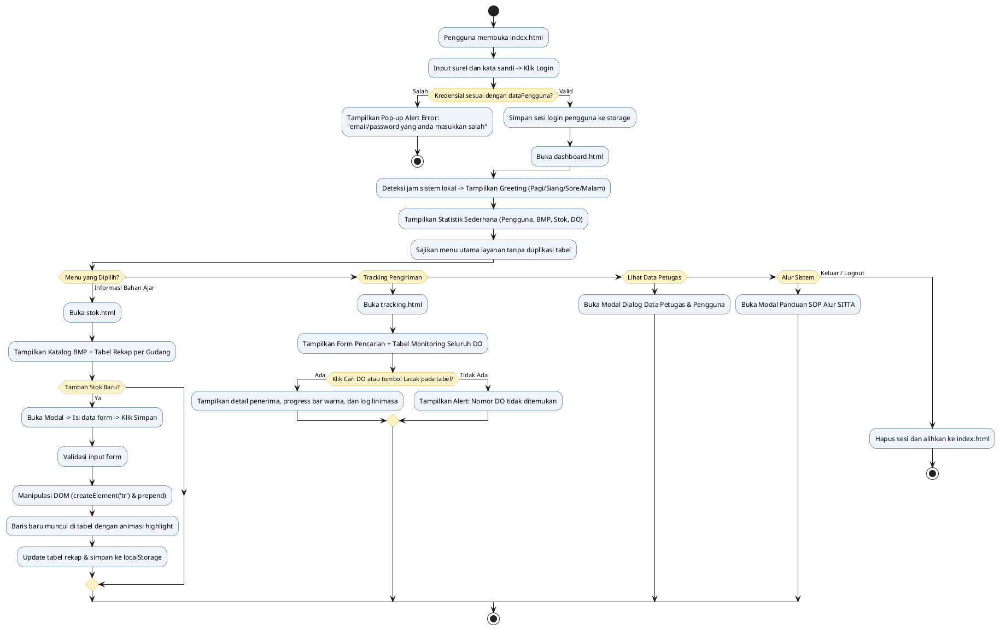

# SITTA UT - Sistem Informasi Tiras dan Transaksi Bahan Ajar Universitas Terbuka
## Tugas Praktik 1: Aplikasi 4 Halaman Berbasis HTML5 Semantik, CSS, dan JavaScript DOM

Aplikasi front-end pemesanan dan distribusi bahan ajar Universitas Terbuka untuk layanan UT-Daerah yang berfokus murni pada arsitektur Front-End (HTML, CSS, JavaScript DOM) tanpa backend, menggunakan berkas `js/data.js` sebagai sumber data resmi.

---

## 1. Struktur Berkas dan Direktori Proyek

```text
sitta-praktik/
├── index.html                  Halaman 1: Login Petugas & Layanan Autentikasi
├── dashboard.html              Halaman 2: Dashboard Menu Utama, Greeting Waktu & Laporan DO
├── tracking.html               Halaman 3: Pelacakan Delivery Order Bahan Ajar
├── stok.html                   Halaman 4: Informasi Persediaan Modul & Tambah Baris DOM
├── css/
│   └── style.css               Berkas Stylesheet Eksternal (UT Design System & Layout)
├── js/
│   ├── data.js                 Datasource Resmi (dataPengguna, dataBahanAjar, dataTracking)
│   └── script.js               Modul Logika Frontend, Validasi Form & Manipulasi DOM
├── README.md                   Dokumentasi Ringkas dan Petunjuk Penggunaan Aplikasi
└── LAPORAN_TUGAS_PRAKTIK_1.md  Laporan Komprehensif Berpraktik & Panduan Video Penjelasan
```

---

## 2. Ringkasan 4 Halaman Utama

### Halaman 1: Halaman Login (`index.html`)
- Formulir otentikasi akun dengan input alamat email dan kata sandi.
- Tombol aksi "Login ke Sistem".
- Penanganan Kesalahan: Jika surel atau kata sandi tidak cocok dengan data pada `dataPengguna`, sistem memunculkan pop-up alert bertuliskan:
  **"email/password yang anda masukkan salah"**
- Tautan "Lupa Password" memunculkan modal dialog untuk instruksi pemulihan kata sandi.
- Tautan "Daftar Akun Baru" memunculkan modal dialog untuk formulir registrasi petugas UT Daerah.
- Tombol Akun Demo cepat untuk pengujian instan (Rina Wulandari, Agus Pranoto, Admin SITTA).

### Halaman 2: Dashboard Menu Utama (`dashboard.html`)
- Ucapan selamat datang (*Greeting*) yang beradaptasi secara otomatis berdasarkan waktu lokal browser (`new Date().getHours()`):
  - Pukul 04:00 - 10:59: Selamat Pagi
  - Pukul 11:00 - 14:59: Selamat Siang
  - Pukul 15:00 - 18:29: Selamat Sore
  - Pukul 18:30 - 03:59: Selamat Malam
- **Statistik Sederhana Sistem SITTA UT (Eksekutif Metrik)**:
  1. **Pengguna Terdaftar**: Total akun aktif dari `dataPengguna.length` (5 pengguna: UPBJJ Jakarta, Makassar, Puslaba, FISIP, Administrator).
  2. **Katalog Bahan Ajar (BMP)**: Total modul BMP aktif dari `dataBahanAjar.length` (5 judul modul).
  3. **Total Persediaan Tiras**: Akumulasi total fisik modul cetak di seluruh gudang (1.587+ eksemplar).
  4. **Transaksi Delivery Order**: Total transaksi pengiriman dari `Object.keys(dataTracking).length` (10 DO lengkap).
- **Visualisasi Grafik / Charts Statistik**:
  1. **Grafik Stok Tiras per Lokasi Gudang (Bar Chart)**: Diagram batang komparasi kuantitas eksemplar modul siap kirim di tiap UPBJJ (Makassar: 548, Jakarta: 392, Surabaya: 278, Malang: 165, Bandung: 204).
  2. **Grafik Distribusi Status DO & Ekspedisi (Breakdown Chart)**: Persentase status pengiriman (40% Selesai Antar, 40% Dalam Perjalanan, 20% Diproses di Hub) dan rasio kurir logistik (50% JNE vs 50% Pos Indonesia).
- **Menu Utama Layanan SITTA (Bersih & Tanpa Duplikasi Menu)**:
  - Navigasi ke **Informasi & Rekap Bahan Ajar** (`stok.html`)
  - Navigasi ke **Tracking & Monitoring DO** (`tracking.html`)
  - Modal Box **Data Petugas Sistem**: Rincian akun pengguna dan wilayah kerja
  - Modal Box **Panduan Alur Layanan SITTA**: SOP tahapan distribusi modul dari gudang ke mahasiswa
- Tombol "Keluar" (Logout) untuk mengakhiri sesi pengguna.

### Halaman 3: Tracking Pengiriman (`tracking.html`)
- Kolom pencarian Nomor Delivery Order (contoh: `2023001234` atau `2023005678`).
- Tombol aksi "Cari" (dan dukungan tombol Enter serta Quick Chips).
- Hasil Pencarian Dinamis:
  - Nama Mahasiswa / Penerima
  - Status Pengiriman (disimulasikan dengan visual progress bar dan badge warna)
  - Rincian metadata: Kurir ekspedisi, tanggal kirim, jenis paket/lokasi, dan total pembayaran.
  - Linimasa Riwayat Perjalanan Paket: Menampilkan log waktu dan keterangan pergerakan barang.
- **Tabel Monitoring Progress Seluruh DO Bahan Ajar**:
  - Menampilkan ringkasan seluruh transaksi DO dari variabel `dataTracking`.
  - Kolom Nomor DO, Penerima, Ekspedisi, Tanggal, Status & Progress Bar warna, Total Biaya.
  - Tombol aksi **"Lacak DO Ini"** pada setiap baris untuk melacak langsung nomor DO tersebut ke panel linimasa di atas.

### Halaman 4: Informasi Stok Bahan Ajar (`stok.html`)
- Merender persediaan modul BMP secara dinamis dari variabel konstanta `dataBahanAjar`.
- Fitur Filter dan Live Search berdasarkan kode lokasi gudang dan pencarian teks nama modul.
- **Fitur Tambah Baris Stok Baru Menggunakan Manipulasi DOM**:
  - Tombol "Tambah Bahan Ajar Baru (DOM)" memicu modal formulir.
  - Validasi input kelengkapan kolom dan kuantitas numerik positif.
  - Manipulasi JavaScript DOM secara langsung menggunakan `document.createElement('tr')`, pengaturan `innerHTML` semantik, dan penyisipan baris ke tabel dengan `tableBody.prepend(newRow)`.
  - Disertai efek animasi visual highlight keemasan (`highlight-new-row`) dan tersimpan secara persisten ke dalam `localStorage`.
  - Tombol "Reset Default" untuk mengembalikan tabel ke 5 data awal.
- **Tabel Rekapitulasi Bahan Ajar per Lokasi Gudang**:
  - Rekapitulasi kuantitas tiras modul per kode lokasi gudang (0TMP01, 0JKT01, 0SBY02, 0MLG01, 0UPBJJBDG).
  - Kalkulasi total akumulasi eksemplar yang terbarui secara otomatis saat stok baru ditambahkan.

---

## 3. Alur Kerja Program (Diagram PlantUML)



---

## 4. Laporan Resmi dan Naskah Video Presentasi

Laporan akademik lengkap yang memuat matriks pemenuhan rubrik nilai, arsitektur 3 jenis gaya CSS, pemetaan kode per halaman, dan naskah panduan presentasi video berdurasi maksimal 15 menit dapat dipelajari pada berkas:

**[LAPORAN_TUGAS_PRAKTIK_1.md](./LAPORAN_TUGAS_PRAKTIK_1.md)**

---

## 5. Panduan Instalasi dan Menjalankan di Komputer Lokal

Karena proyek ini dibangun murni menggunakan standar **HTML5, CSS3, dan JavaScript DOM murni (Native)** tanpa ketergantungan backend database, Anda memiliki beberapa cara mudah untuk menjalankan aplikasi ini di komputer lokal:

### Cara 1: Langsung Buka di Browser (Tanpa Instalasi Apapun - Paling Cepat)
1. Unduh atau ekstrak seluruh folder proyek ini ke komputer Anda.
2. Pastikan struktur folder tetap terjaga (`index.html`, `dashboard.html`, `stok.html`, `tracking.html`, folder `css/`, dan folder `js/`).
3. Klik ganda (*double click*) pada berkas **`index.html`**.
4. Berkas akan langsung terbuka di browser web favorit Anda (Google Chrome, Microsoft Edge, Mozilla Firefox, dsb.).

### Cara 2: Menggunakan VS Code Live Server (Sangat Direkomendasikan)
1. Buka folder proyek menggunakan aplikasi **Visual Studio Code**.
2. Masuk ke menu Extensions (`Ctrl + Shift + X` atau `Cmd + Shift + X`), lalu cari dan pasang ekstensi **Live Server** (karya Ritwick Dey).
3. Klik kanan pada berkas **`index.html`** di panel Explorer, lalu pilih **"Open with Live Server"**.
4. Halaman login akan otomatis terbuka di browser dengan alamat `http://127.0.0.1:5500/index.html`. Kelebihannya, setiap perubahan kode akan otomatis ter-refresh (*live reload*).

### Cara 3: Menggunakan Node.js / NPM (Sesuai Konfigurasi Vite)
Jika Anda memiliki Node.js di komputer:
```bash
# 1. Buka terminal di dalam folder proyek
cd sitta-praktik

# 2. Pasang dependensi
npm install

# 3. Jalankan server lokal
npm run dev
```
Buka browser dan akses alamat: **`http://localhost:3000`**.

### Cara 4: Menggunakan Python Built-in Server
Jika di komputer Anda sudah terpasang Python:
```bash
# Untuk Python 3
python -m http.server 3000
# atau
python3 -m http.server 3000
```
Buka browser dan akses alamat: **`http://localhost:3000`**.

### Kredensial Akun untuk Pengujian Login:
- **Email:** `rina@ut.ac.id` | **Password:** `rina123` (Role: UPBJJ-UT Jakarta)
- **Email:** `agus@ut.ac.id` | **Password:** `agus123` (Role: UPBJJ-UT Makassar)
- **Email:** `admin@ut.ac.id` | **Password:** `admin123` (Role: Administrator Pusat)
