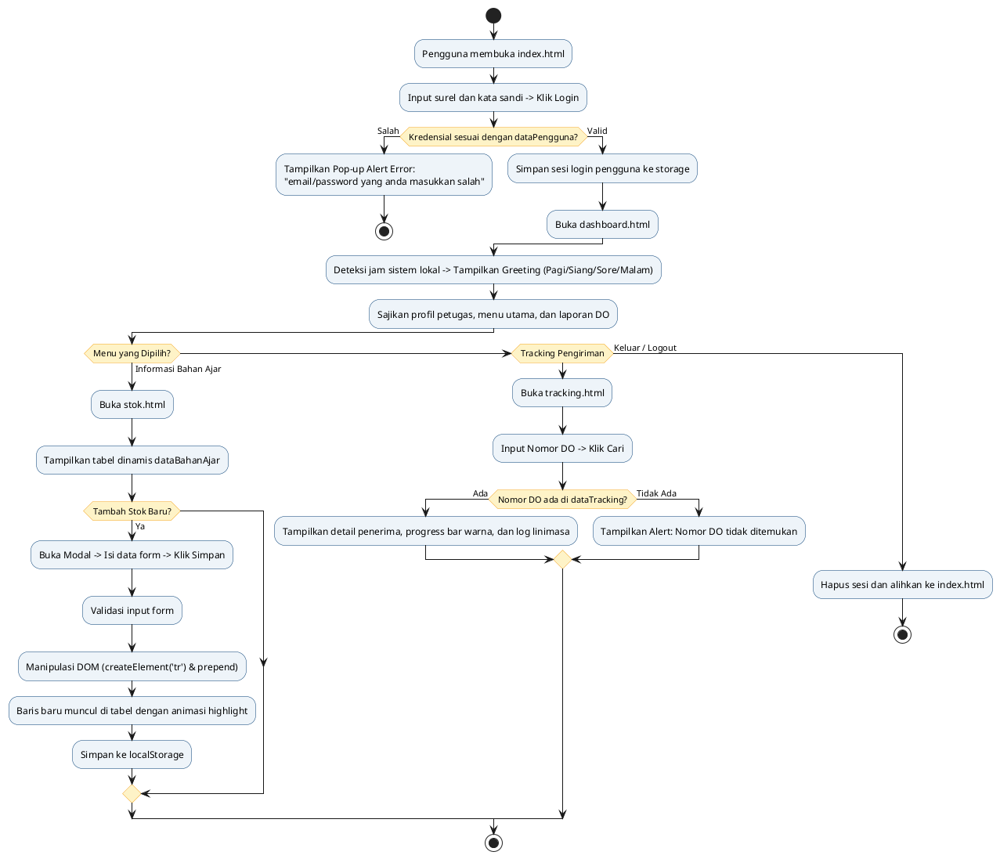

# SITTA UT - Sistem Informasi Tiras dan Transaksi Bahan Ajar Universitas Terbuka
## Tugas Praktik 1: Aplikasi 4 Halaman Berbasis HTML5 Semantik, CSS, dan JavaScript DOM

Aplikasi front-end pemesanan dan distribusi bahan ajar Universitas Terbuka untuk layanan UT-Daerah yang berfokus murni pada arsitektur Front-End (HTML, CSS, JavaScript DOM) tanpa backend, menggunakan berkas `js/data.js` sebagai sumber data resmi.

---

## 1. Struktur Berkas dan Direktori Proyek

```text
sitta-praktik/
├── index.html                  Halaman 1: Login Petugas & Layanan Autentikasi
├── dashboard.html              Halaman 2: Dashboard Menu Utama, Greeting Waktu & Laporan DO
├── tracking.html               Halaman 3: Pelacakan Delivery Order Bahan Ajar
├── stok.html                   Halaman 4: Informasi Persediaan Modul & Tambah Baris DOM
├── css/
│   └── style.css               Berkas Stylesheet Eksternal (UT Design System & Layout)
├── js/
│   ├── data.js                 Datasource Resmi (dataPengguna, dataBahanAjar, dataTracking)
│   └── script.js               Modul Logika Frontend, Validasi Form & Manipulasi DOM
├── README.md                   Dokumentasi Ringkas dan Petunjuk Penggunaan Aplikasi
└── LAPORAN_TUGAS_PRAKTIK_1.md  Laporan Komprehensif Berpraktik & Panduan Video Penjelasan
```

---

## 2. Ringkasan 4 Halaman Utama

### Halaman 1: Halaman Login (`index.html`)
- Formulir otentikasi akun dengan input alamat email dan kata sandi.
- Tombol aksi "Login ke Sistem".
- Penanganan Kesalahan: Jika surel atau kata sandi tidak cocok dengan data pada `dataPengguna`, sistem memunculkan pop-up alert bertuliskan:
  **"email/password yang anda masukkan salah"**
- Tautan "Lupa Password" memunculkan modal dialog untuk instruksi pemulihan kata sandi.
- Tautan "Daftar Akun Baru" memunculkan modal dialog untuk formulir registrasi petugas UT Daerah.
- Tombol Akun Demo cepat untuk pengujian instan (Rina Wulandari, Agus Pranoto, Admin SITTA).

### Halaman 2: Dashboard Menu Utama (`dashboard.html`)
- Ucapan selamat datang (*Greeting*) yang beradaptasi secara otomatis berdasarkan waktu lokal browser (`new Date().getHours()`):
  - Pukul 04:00 - 10:59: Selamat Pagi
  - Pukul 11:00 - 14:59: Selamat Siang
  - Pukul 15:00 - 18:29: Selamat Sore
  - Pukul 18:30 - 03:59: Selamat Malam
- Kartu Menu Utama:
  1. Informasi Bahan Ajar (navigasi ke `stok.html`)
  2. Tracking Pengiriman (navigasi ke `tracking.html`)
  3. Laporan Monitoring Progress DO Bahan Ajar
  4. Laporan Rekap Bahan Ajar per Lokasi Gudang
  5. Histori Transaksi Bahan Ajar
- Laporan 1: Tabel Monitoring Progress DO dari variabel `dataTracking` dengan visual progress bar warna.
- Laporan 2: Tabel Rekapitulasi Bahan Ajar dari variabel `dataBahanAjar` dengan kalkulasi akumulasi total tiras.
- Tombol "Keluar" (Logout) untuk mengakhiri sesi pengguna.

### Halaman 3: Tracking Pengiriman (`tracking.html`)
- Kolom pencarian Nomor Delivery Order (contoh: `2023001234` atau `2023005678`).
- Tombol aksi "Cari" (dan dukungan tombol Enter).
- Hasil Pencarian Dinamis:
  - Nama Mahasiswa / Penerima
  - Status Pengiriman (disimulasikan dengan visual progress bar dan badge warna)
  - Rincian metadata: Kurir ekspedisi, tanggal kirim, jenis paket/lokasi, dan total pembayaran.
  - Linimasa Riwayat Perjalanan Paket: Menampilkan log waktu dan keterangan pergerakan barang.
- Umpan Balik Error: Jika nomor DO tidak ditemukan, memunculkan alert box error.

### Halaman 4: Informasi Stok Bahan Ajar (`stok.html`)
- Merender persediaan modul BMP secara dinamis dari variabel konstanta `dataBahanAjar`.
- Fitur Filter dan Live Search berdasarkan kode lokasi gudang dan pencarian teks nama modul.
- **Fitur Tambah Baris Stok Baru Menggunakan Manipulasi DOM**:
  - Tombol "Tambah Bahan Ajar Baru (DOM)" memicu modal formulir.
  - Validasi input kelengkapan kolom dan kuantitas numerik positif.
  - Manipulasi JavaScript DOM secara langsung menggunakan `document.createElement('tr')`, pengaturan `innerHTML` semantik, dan penyisipan baris ke awal tabel dengan `tableBody.prepend(newRow)`.
  - Disertai efek animasi visual highlight keemasan (`highlight-new-row`) dan tersimpan secara persisten ke dalam `localStorage`.
  - Tombol "Reset Default" untuk mengembalikan tabel ke 5 data awal.

---

## 3. Alur Kerja Program (Diagram PlantUML)



---

## 4. Laporan Resmi dan Naskah Video Presentasi

Laporan akademik lengkap yang memuat matriks pemenuhan rubrik nilai, arsitektur 3 jenis gaya CSS, pemetaan kode per halaman, dan naskah panduan presentasi video berdurasi maksimal 15 menit dapat dipelajari pada berkas:

**[LAPORAN_TUGAS_PRAKTIK_1.md](./LAPORAN_TUGAS_PRAKTIK_1.md)**
